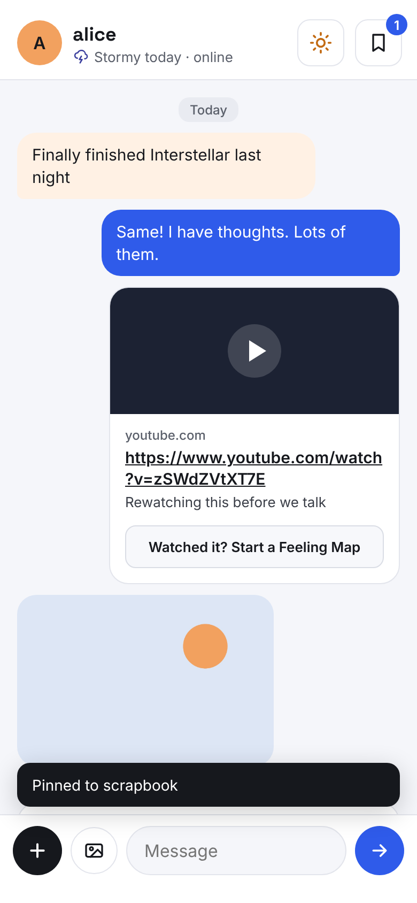
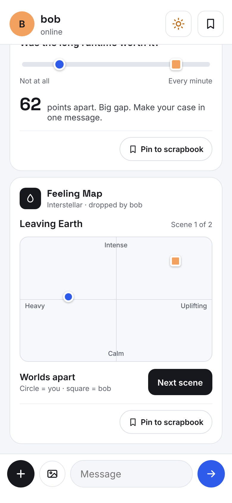
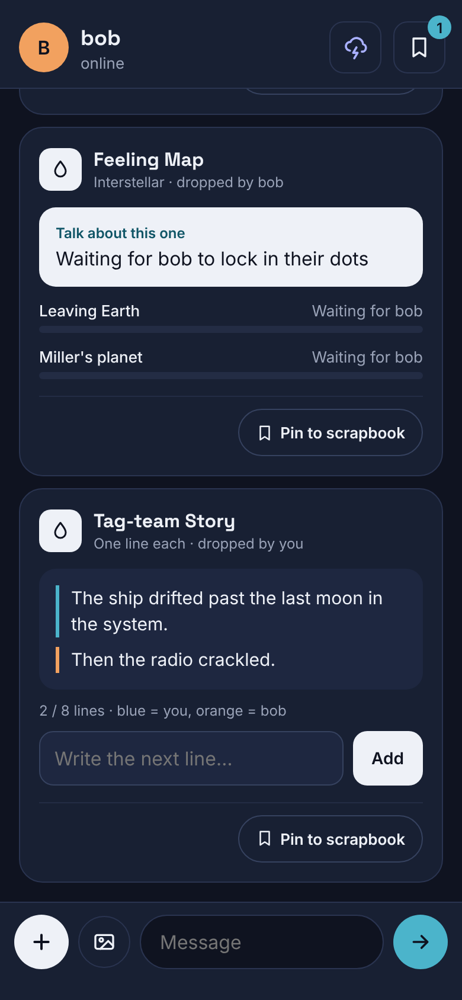
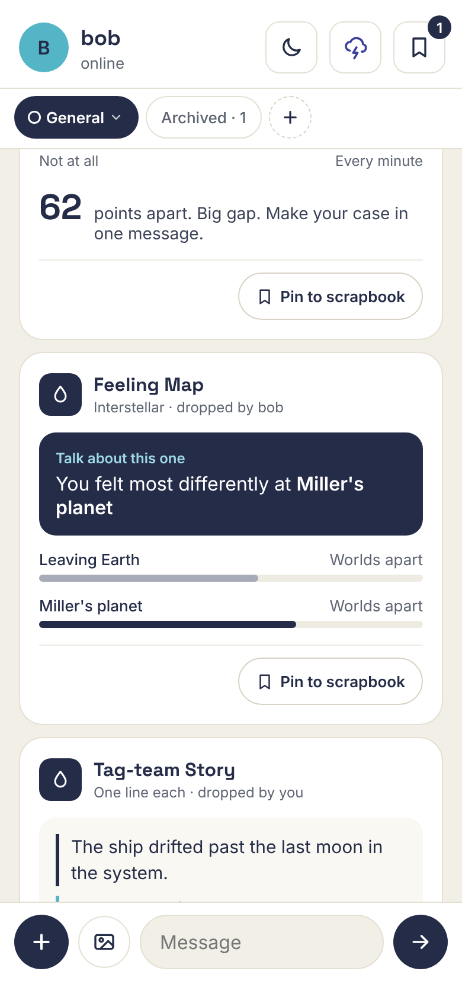
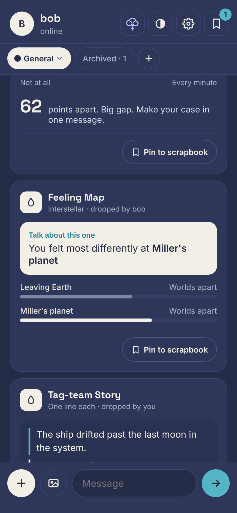

# Hi · Drops Chat

Private one-to-one chats: add as many contacts as you like, and each chat is just the two of you. Every chat has **Tabs** (several parallel conversations, each with its own unread count) and **Drops**: interactive cards you play together in the conversation.

- **Feeling Map**: each of you plots how every scene felt on an intense/calm × heavy/uplifting grid. Dots stay hidden until you both lock in.
- **Blind Reveal**: answer a question privately, then flip together.
- **Gap Slider**: slide your take, then see how many points apart you are.
- **Tag-team Story**: write a story one line each.

It also has text, link previews, photos, **message actions** (long-press a message: reply-quote, reactions, phrase reactions, copy, pin, edit within 15 minutes, select several, delete for me or for everyone), a shared scrapbook of pinned moments, "mood weather" next to your name, push notifications, and a **light/dark switch** in the header (Hi Light on alabaster, Hi Dark on navy) plus more colour themes (Classic, Blossom, Forest, or match your phone).

It's an installable PWA (iPhone and Android) built with Vite + Preact + TypeScript on Firebase, and it's ready to wrap with Capacitor later.
The UI follows the design prototype in `design/`, with the "Hi" navy, teal and alabaster palette as the default theme (the prototype's original colours are the **Classic** theme). `Chat-with-Drops-standalone.html` opens directly in any browser (fonts included); `Chat-prototype.html` is the same design as source markup.

| Chat | Feeling Map | Summary & story |
|---|---|---|
|  |  |  |

| Hi Light | Hi Dark | Theme picker |
|---|---|---|
|  |  |  |

---

## Contents

1. [Run it locally (Emulator Suite)](#1-run-it-locally-emulator-suite)
2. [Tests](#2-tests)
3. [Create the Firebase project](#3-create-the-firebase-project)
4. [Blaze plan + $1 budget alert](#4-blaze-plan--1-budget-alert)
5. [Fill in the config](#5-fill-in-the-config)
6. [Deploy to Firebase Hosting](#6-deploy-to-firebase-hosting)
7. [Install on iPhone (and Android)](#7-install-on-iphone-and-android)
8. [How it works](#8-how-it-works)
9. [Later: native apps with Capacitor](#9-later-native-apps-with-capacitor)

---

## 1. Run it locally (Emulator Suite)

You need **Node 22** and **Java 11+** (the Firestore and Storage emulators run on Java).

```bash
npm install
```

```bash
npm --prefix functions install
```

```bash
npm run dev:all
```

This builds the Cloud Functions, starts the emulators (Auth, Firestore, Storage, Functions, plus the UI at
http://127.0.0.1:4000), and starts the app at **http://localhost:5173**.

`dev:all` always runs against the emulators (project `demo-drops`), never your real `hi-dropchat` data. `npm run dev` on its own runs the app against the **real** project in `src/firebase-config.ts`.

**Signing in locally:** use "E-mail me a sign-in link". The emulator doesn't send e-mail. Open
**Emulator UI → Authentication** (or look in the terminal) and click the sign-in link. "Continue with Google" also works and shows a fake account picker.

**Two people:** use a normal window and a private window (or two browsers). Sign in as `a@example.com`, tap **Add contact → Create invite link → Copy link**, open that link in the other window, sign in as `b@example.com` and tap **Join**.

**On your phone (same Wi-Fi):** the emulators listen on `127.0.0.1` only. To test from a phone, change every `"host": "127.0.0.1"` in `firebase.json` to `"0.0.0.0"`, then open `http://<your-computer's-LAN-IP>:5173`. The app looks for the emulators on the same host it was loaded from.

Emulator data is saved to `.emulator-data/` when you stop the emulators.

## 2. Tests

```bash
npm test
```

This runs three suites:

| Suite | What it checks |
|---|---|
| `npm run test:unit` | Link detection, image sizing, labels, Drop registry (every Drop definition is valid) |
| `npm run test:rules` | **Firestore + Storage security rules** against the emulators: only members can read/write, you can only write your own answers, a hidden answer can't be read until both lock in, locked answers are frozen, a third person can never join, photo and voice uploads limited to your own folder and 5 MB, voice notes' played marks and timed reactions are your own only |
| `npm --prefix functions test` | Open Graph parsing, SSRF protection for link previews, push text never leaking answers |

There is also a full end-to-end run: two browsers sign in, pair up, chat, send a photo, play the Drops (including Poll, Two Truths & a Lie, Decision Wheel and Today's question) and use a thread, against the emulators.

```bash
npm run test:e2e
```

It needs Playwright's Chromium. If you don't have it, run `npx playwright install chromium` once. Screenshots go to `test-results/e2e/`.

## 3. Create the Firebase project

> ✅ Done for `hi-dropchat`: the web config is already in `src/firebase-config.ts` and `.firebaserc`. Check the sign-in providers, Firestore and Storage (steps 2–4), and generate the Web Push key (step 6).

1. Go to https://console.firebase.google.com and choose **Add project**. Name it something like `drops-chat`. Google Analytics isn't needed.
2. **Build → Authentication → Get started.** Then:
   - **Sign-in method → Google**: Enable, pick a support e-mail, Save.
   - **Sign-in method → Email/Password**: Enable, also turn on **Email link (passwordless sign-in)**, Save.
3. **Build → Firestore Database → Create database.** Choose **Production mode** (our rules get deployed over it) and a location near you. You can't change the location later.
4. **Build → Storage → Get started.** This needs the Blaze plan (next step). Use the same location.
5. **Project settings (⚙) → General → Your apps → Web (`</>`).** Register an app called "Drops Chat". You don't need Firebase Hosting setup here. Copy the `firebaseConfig` object.
6. **Project settings → Cloud Messaging → Web configuration → Web Push certificates → Generate key pair.** Copy the key. This is the `vapidKey`.

## 4. Blaze plan + $1 budget alert

Cloud Functions (link previews, push), and Storage on new projects, need the pay-as-you-go **Blaze** plan.
Two people chatting will stay well inside the free quotas, so expect **$0**. The alert is there as a safety net.

1. In the Firebase console, click **Upgrade** (bottom-left, next to "Spark") and choose **Blaze**. Link or create a Cloud Billing account.
2. When asked to set a budget, enter **1** (USD) and confirm. If you skipped it, set one up as follows:
   - Open https://console.cloud.google.com/billing, choose your billing account, then **Budgets & alerts → Create budget**.
   - **Scope:** select your Firebase project only.
   - **Amount:** *Specified amount* → **$1**.
   - **Actions:** keep the 50%, 90% and 100% thresholds and tick **Email alerts to billing admins and users**.
   - Click **Finish**.
3. A budget only **alerts** you; it doesn't stop billing. The functions are capped at 3 instances each (`functions/src/index.ts`) to keep any runaway cost small. If you ever want a hard stop, Google documents a "cap costs by disabling billing" Pub/Sub recipe.

## 5. Fill in the config

> ✅ Already filled in for `hi-dropchat`, except **`vapidKey`** (step 3.6). It's needed for notifications.

For reference, **`src/firebase-config.ts`** looks like this:

```ts
export const firebaseConfig = {
  apiKey: '…',
  authDomain: 'your-project-id.web.app',   // ← see note below
  projectId: 'your-project-id',
  storageBucket: 'your-project-id.firebasestorage.app',
  messagingSenderId: '…',
  appId: '…',
};
export const vapidKey = 'B…';               // from step 3.6
```

> **Sign-in on iPhone:** set `authDomain` to the domain you serve the app from (`your-project-id.web.app`, or your custom domain), **not** `*.firebaseapp.com`. Then the Google sign-in redirect stays on the same site, which Safari and installed Home Screen apps need.

`.firebaserc` already points at `hi-dropchat`. Log the CLI in once:

```bash
npx firebase login
```

Firestore and Functions regions: Functions default to `us-central1`. If your Firestore is elsewhere (for example `europe-west1`), change `region` in `functions/src/index.ts` to match. That's faster, and some regions require it for Firestore triggers.

## 6. Deploy to Firebase Hosting

```bash
npm run deploy
```

That builds the app and the functions, then deploys **Hosting, Firestore rules and indexes, Storage rules, and Functions** in one go. The first deploy may ask you to:

- **Enable APIs** (Cloud Functions, Cloud Build, Artifact Registry, Eventarc): answer **Yes**.
- **Grant Storage access to Firestore** for the cross-service rules (photos are readable only by room members, which the Storage rules check in Firestore): answer **Yes**.

Your app is live at `https://your-project-id.web.app`. Then:

- **Authentication → Settings → Authorized domains:** `your-project-id.web.app` and `firebaseapp.com` are already there. Add any custom domain you use.
- Open the app, sign in, tap **Add contact** and **Share invite link**. Whoever opens the link first (after signing in) joins that chat.

To deploy only one part later: `npx firebase deploy --only hosting`, `--only firestore:rules,storage`, or `--only functions`.

### Automatic deploys from GitHub

`.github/workflows/deploy.yml` runs the tests on every pull request. When something is merged into `main`, it runs them again and then publishes the **website** and **Firestore rules** to `hi-dropchat`. You don't need a terminal. It needs one secret, set up once:

1. **Create a deploy account.** Open the [service accounts page for hi-dropchat](https://console.cloud.google.com/iam-admin/serviceaccounts?project=hi-dropchat) and sign in with the Google account that owns the Firebase project.
   - Click **+ Create service account**. Name: `github-deploy`. Click **Create and continue**.
   - **Roles:** search for **Firebase Admin** and select it. Then click **+ Add another role** and add **Service Usage Consumer**, which lets the deploy check which Google services are switched on. Click **Continue**, then **Done**.
   - If a deploy fails with `Permission denied` or `The caller does not have permission`, open the failed run's **deploy** log. The line `Deploying as: …@….iam.gserviceaccount.com` shows which account's key is in the secret, and that account needs both roles. Add it at **IAM & Admin → IAM**: find the account and click the ✏️ pencil.
2. **Download its key.** Click the new `github-deploy` account, then the **Keys** tab, then **Add key → Create new key → JSON → Create**. A `.json` file downloads.
3. **Give it to GitHub.** In this repo, go to **Settings → Secrets and variables → Actions → New repository secret**.
   - Name: `FIREBASE_SERVICE_ACCOUNT`
   - Secret: open the downloaded `.json` file in a text editor and paste **all** of it.
   - Click **Add secret**.
4. Delete the downloaded `.json` file from your computer. GitHub keeps the only copy it needs. If it ever leaks, delete the key on the same Keys tab and repeat steps 2–3.
5. **Run it.** Merge a pull request, or open **Actions → Test and deploy → Run workflow** (branch `main`). After about 3 minutes, https://hi-dropchat.web.app is live. The Actions tab shows each run, with a red ✗ and the reason if something failed.

**After you move to Blaze:** to also deploy the Storage rules and Cloud Functions (photos, link previews, push), go to **Settings → Secrets and variables → Actions → Variables → New repository variable**, set `DEPLOY_BACKEND` = `true`, and give the `github-deploy` account three more roles: **Cloud Functions Admin**, **Service Account User** and **Cloud Scheduler Admin** (for `minuteJob`). The first Functions deploy can take about 5 minutes.

## 7. Install on iPhone (and Android)

**iPhone / iPad (iOS 16.4+ for notifications):**

1. Open `https://your-project-id.web.app` in **Safari**. It has to be Safari: other iOS browsers can't install web apps with push.
2. Tap **Share** (the square with an up arrow), then **Add to Home Screen**, then **Add**.
3. Open **Drops** from the Home Screen and sign in *inside the app*. The installed app has its own storage, separate from Safari.
   - **Google:** works directly if `authDomain` is your `web.app` domain (step 5).
   - **E-mail link:** the link in the e-mail opens in Safari, not in the installed app. In the app, after "Send link", **long-press the link in Mail → Copy**, then paste it into "Sign in with pasted link".
4. Tap **Turn on** in the notification banner (or **mood weather button → Notifications → Turn on**) and allow notifications.

**Android (Chrome):** open the site and tap **Install app** (or ⋮ → *Add to Home screen*). Notifications work in the browser as well as installed.

## 8. How it works

```
src/
  firebase-config.ts     the hi-dropchat web config (+ vapidKey to add)
  lib/themes.ts          colour themes (add one by adding a palette)
  firebase.ts            init + emulator wiring + offline cache
  app.tsx                auth → chat list (or a share-link join) → chat
  ui/                    Chats (list), Chat, MessageActions, AddContactSheet, JoinScreen, DropCard (host for plugins), sheets, bubbles, sign-in
  drops/
    types.ts             the Drop plugin contract (defineDrop, DropApi)
    registry.ts          auto-discovers *.drop.tsx
    feeling-map.drop.tsx, blind-reveal.drop.tsx, gap-slider.drop.tsx, tag-team-story.drop.tsx
  data/                  Firestore/Storage/FCM access, one file per concern
public/sw.js             service worker: offline shell + push display
functions/src/           linkPreview (Open Graph), notifyPartner (FCM), deleteMessageFiles (photo + voice cleanup)
firestore.rules          the security model, documented inline
storage.rules
tests/                   unit, rules, e2e
docs/ADDING_A_DROP.md    how to add a new Drop
```

### Data model

```
rooms/{roomId}                      one chat: owner, members (max 2), invites [e-mail], inviteCode (share link),
                                    lastMessage (chat-list preview), left (who left), timezone (Indian/Maldives)
  members/{uid}                     name, photo, mood weather, lastSeen, typing (+tab), lastRead {tabId: time}
  tabs/{tabId}                      name, colour, archived, order, lastMessageAt   ("general" always exists)
    messages/{id}                   text | link | photo | voice | drop, + replyTo, editedAt, reactions {code: [uid]},
                                    phraseReactions, hiddenFor [uid], deleted, urgent, scheduled,
                                    voice {path, durationMs, peaks, mime}, playedBy [uid], voiceReactions
  scheduled/{id}                    a scheduled message; only its sender can see it (id = the message id it becomes)
  pins/{id}                         scrapbook
  drops/{dropId}                    type + content (the Drop's JSON definition snapshot)
    sealed/{uid}_{key}              a PRIVATE answer
    locks/{uid}_{key}               public "I've locked {key}" marker
    entries/{id}                    public, append-only lines
    users/{uid}                     public per-person progress
profiles/{uid}                      public profile: name, photo (small inline JPEG), about, note {text, emoji, at}
users/{uid}                         theme, readReceipts, quiet {on, start, end, tz}; urgent {day, count} (server only)
  tokens/{fcmToken}                 push tokens (private)
  reads/{roomId}                    my own "read up to" per tab (private; works with read receipts off)
  held/{id}                         notifications held during quiet hours (server only)
  contacts/{uid}                    my nickname for them, muted / mutedUntil (private)
  blocked/{uid}                     people I blocked (private)
```

### Why the hidden answers really are hidden

This is enforced in `firestore.rules`, not just in the UI, and covered by `tests/rules/firestore.test.ts`:

- A `sealed` answer can be read by its owner. The **other** member can read it only if the owner has locked it **and** the reader has a lock marker for the same key.
- A lock marker can only be created in the same atomic write as locking your own answer (`getAfter`). So you can't peek without committing.
- Once locked, an answer can never be changed.
- Queries on `sealed` are only allowed when filtered to your own uid, so nobody can list the other person's answers.

### Contacts, chats and invites

- Every chat is a room of exactly two people. You can have as many as you like: the **Chats** screen lists them (newest first, with the other person's mood face, a preview and an unread dot). Opening the app goes back to the chat you last had open, or straight in when you only have one. The back arrow (or the phone's back gesture) returns to the list.
- **Add contact** makes a new chat with a secret **invite link** (`?join=<room>&code=<22 random characters>`). Share it any way you like. Whoever opens it first, signs in and taps **Join** becomes the other person. The code is used up in the same write, so the link can't add anyone else. You can make a new link (the old one stops working) or remove an invite nobody has used.
- You can also add their **e-mail**. **Hi doesn't send any e-mail**: adding it only lets that address (once signed in with it, verified) see the invite in their chat list and tap **Accept**. Send the link too.
- Strangers can't read a room or its messages. Joining by code is a write-only check in `firestore.rules`: only your own uid can be added, only while the room has one member, and only with the matching code. All of it is covered by `tests/rules/firestore.test.ts`.
- A link opened before signing in is remembered (for a day) through the sign-in, including Google's redirect. If you already have a chat with the person who sent it, Hi opens that one instead of making a second.
- You can chat in a new room before anyone joins. The room, your profile and its General tab are created in one atomic write, so a room never exists half set-up.

### Profiles, notes and safety

- **Profile.** The first time you sign in, Hi asks for your name (filled in from Google, or from your e-mail), a photo and an optional *About* line. Photos are cropped square and saved as a small JPEG inside your profile document, so they work on the free plan without Cloud Storage. Change it any time: tap your picture on **Chats**, or **Settings → Edit profile**.
- **Notes.** A 60-character status with an emoji, shown above your picture on everyone's **Chats** screen for 24 hours. Tap someone's note to reply. The reply lands in your chat with them, quoting the note.
- **Contact profile.** Tap the picture at the top of a chat: their photo, About, mood and note, how long you've been chatting, and:
  - **Nickname**: what *you* call them. Only you see it.
  - **Mute notifications** for that chat (the push function skips it).
  - **Remove contact**: you leave the chat. They keep a read-only copy ("X left this chat") with a **Delete chat** button. A chat someone left can never be re-joined.
  - **Block**: also removes the contact, and they can't join any chat you invite them to (checked in the rules). Unblock in **Settings**.
- **Delete account** (Settings, two steps): you leave every chat, chats only you are in are deleted, your profile, note, nicknames, blocks and push tokens are erased, then the sign-in account itself. It uses the `deleteAccount` Cloud Function; until functions are deployed (Blaze), the app does the same steps itself, and may ask you to sign in again first.
- Profiles have no e-mail address in them. Any signed-in person can read a profile, but only if they know the uid, which only people you share a chat with ever see.

### Message actions

Long-press a message (or right-click / the ⋯ button on a computer) for **Reply · React · Copy · Pin · Edit · Select · Delete**:

- **Reply** quotes the message above the composer and in the sent bubble. Tap the quote to jump to the original.
- **React** with ❤️ 😂 😮 😢 👍 🔥. Chips under the bubble show counts; tap one to add or remove yours. **Phrase react**: tap the first and last word, then a reaction. The phrase is underlined with a small chip.
- **Edit** your own text for 15 minutes ("edited" shows on the bubble). **Copy** and **Pin** (to the scrapbook) work on single messages or a selection.
- **Delete for me** hides it on your devices (5-second Undo). **Delete for everyone** (your own messages, after a second confirmation) clears the content for both of you and leaves "Message deleted"; a Cloud Function also deletes the photo file.
- The rules enforce each of these: only the sender edits (within 15 minutes) or deletes for everyone, and reactions, phrase reactions and "delete for me" can only add or remove your own uid.

### Delivery: ticks, scheduled messages, quiet hours

- **Ticks** on your messages: a clock while it's still on your phone, ✓ once the server has it, ✓✓ once they've read it. Only the newest read message says "Read".
- **Read receipts** (Settings) are on by default. Turning them off works both ways, like WhatsApp: they don't see when you've read theirs and you don't see theirs. Your own unread counts keep working from a private copy (`users/{uid}/reads`).
- **Not sent**: if the server refuses a message, it stays in the chat as "Not sent · Tap to retry" (kept on that phone). With no signal, messages just wait with a clock and send when you're back online.
- **Press and hold Send** (or right-click it) for:
  - **Schedule…**: Tonight 8 pm, Tomorrow 8 am, Next Monday 9 am, or any date and time, in your phone's time zone. A strip above the composer lists them, with Edit · Send now · Cancel. Nobody else can see them until they're sent, and they show "· scheduled".
  - **Send as urgent**: breaks through the other person's quiet hours. Three a day, counted by the server.
- **Sending on time:** while you have the app open, it sends your scheduled messages itself. With Cloud Functions deployed (Blaze), `minuteJob` sends them every minute even when your phone is off. The message takes the scheduled message's id, and the rules only allow that write if it removes the scheduled one, so it's never sent twice.
- **Quiet hours** (Settings, off by default, 21:00–07:00): `notifyPartner` holds your notifications and `minuteJob` sends one summary when they end ("3 messages from Sam, 1 from Alex"). Messages still arrive in the app straight away. This part needs Cloud Functions.
- **Mute a chat** from the ⋯ on its row in Chats: for 8 hours, a week, or always.

### Link previews and push

- **`linkPreview`** runs when a link message is created. It fetches the page (public hosts only: private, loopback and metadata IPs are blocked and re-checked on every redirect; 6 s timeout; 600 KB cap), reads `og:` / `twitter:` / `<title>` tags, and fills them into the message.
- **`notifyPartner`** sends a Web Push to the other person's devices, unless they muted that chat or it's their quiet hours (then it's held for the summary, unless the message is Urgent). The text never contains Drop answers. Dead tokens are cleaned up automatically.
- **`minuteJob`** (every minute, Cloud Scheduler) sends due scheduled messages and the quiet-hours summaries.
- **`deleteAccount`** (callable) deletes your account and data, as described above.

### Photos

Photos are re-encoded in the browser to JPEG, longest side **1600 px** (this also strips EXIF/GPS), then uploaded to `rooms/{roomId}/photos/{uid}/…`. Storage rules allow members to read, and the owner to write once (≤ 5 MB, images only).

**Viewer:** tap a photo to open it full screen.
- Swipe sideways for the chat's other photos, and swipe down to close.
- Pinch, double-tap or use the mouse wheel to zoom; drag to pan.
- **Save** shares or downloads the photo, and **Pin to scrapbook** pins it.
- Escape or the phone's back gesture closes the viewer without leaving the chat.

### Voice notes

When the message box is empty, the Send button becomes a microphone.

**Recording**
- **Hold** the mic to record and let go to send.
- **Slide left** to cancel, or **slide up** to lock and record hands-free; locked recordings get a delete button and a Send button.
- A **quick tap** (or Enter) also records hands-free.
- A note can be up to **2 minutes**.
- Format: Opus in WebM where the browser supports it, AAC in MP4 on iPhone/Safari.
- The app works out a 64-point waveform on the phone and stores it with the message, so the bubble draws instantly.

**Playing**
- The bubble has play/pause, a waveform that fills as it plays (tap it, or use the arrow keys, to jump), the length, and **1× / 1.5× / 2×**.
- Only one note plays at a time.

**Reactions and played status**
- While listening, tap **☺+** and pick a reaction. It's pinned to that moment and shows as a marker above the waveform; tapping a marker plays from there. **Undo** removes your last one.
- Notes you haven't played have a dot. Once the other person plays yours, it says **Played**.

**Storage**
- Files go to `rooms/{roomId}/voice/{uid}/{id}.webm|m4a`. Members can read them; only the owner can create one (audio only, under 5 MB).
- **Delete for everyone** clears the message, and the `deleteMessageFiles` function removes the audio file.

> Voice notes and photos use Cloud Storage, which needs the **Blaze** plan (section 4) and `DEPLOY_BACKEND=true` so the Storage rules deploy. Until then, sending one says "Voice notes need the Blaze plan — see README".

## Tabs

- Every room has a **General** tab. The **+** at the end of the tab bar adds another (name and colour). Tap the open tab for options: rename, recolour, archive. General can't be archived.
- Unread counts come from `members/{uid}.lastRead[tabId]`, so they sync across your devices. The total also shows on the app icon where the browser supports badges.
- Notifications name the tab ("Sam · Trip plans"), and tapping one opens that chat and tab.
- Drops, docs and sessions belong to a tab. Scrapbook, search and streak are room-wide (see `SPEC.md`).

### Disappearing tabs

- In a tab's options, **Disappearing messages** is **Off / 24 hours / 7 days / 90 days**. Either person can change it; a line in the chat says who did ("Alice turned on disappearing messages (7 days)"), and the tab shows a small timer.
- Each new message in that tab gets `expiresAt` (sent time + the setting). The rules insist it matches the tab's setting (within an hour, for phone clocks), and that normal tabs have none.
- The app hides a message the moment it expires. A Firestore **TTL policy** on `messages.expiresAt` then deletes it, usually within a day, and the `deleteRemovedFiles` function removes its photo or voice file. Pins are copies, so they stay in the scrapbook.
- **One-time setup:** the TTL policy is in `firestore.indexes.json`. With `DEPLOY_BACKEND=true` the GitHub deploy applies it. Without that, run this once from a computer signed in to Firebase:

  ```bash
  npx firebase deploy --only firestore:indexes --project hi-dropchat
  ```

  (Or in the Google Cloud console: **Firestore → Time-to-live → Create policy**, collection group `messages`, field `expiresAt`.) Until it's set, expired messages are still hidden in the app but stay in the database.

### Search

- **In a chat:** the magnifier at the end of the tab bar searches every tab of that chat, archived ones too. Results are grouped by tab; tap one to jump to the message (older messages are loaded as needed) and it flashes.
- **All chats:** the magnifier on the Chats screen searches every chat, grouped by person.
- It matches all the words you type, in any order, ignoring case and accents, in messages, photo captions and link titles and descriptions. Matches are highlighted.
- **Filters:** Photos (a grid), Links, Voice and Drops. With no words, a filter lists everything of that kind, so it doubles as the chat's media gallery (also under the contact's profile → **Photos, links & voice**).
- Firestore has no full-text search, so the app reads the latest **2,000 messages of each chat** and searches them on the phone. Deleted, deleted-for-me and expired messages are never shown.

### Export

Open the contact's profile → **Export chat**, then choose the whole chat or just the open tab:

- **PDF:** the app lays the chat out as a printable page (title, both names, date range, then each tab by day, with photo thumbnails and reactions) and opens the print screen, where you choose **Save as PDF**. No PDF library is shipped.
- **ZIP:** `chat.txt` (readable), `chat.json` (data) and the photos and voice notes, fetched from Storage. Any file that can't be fetched is listed in `missing.txt`. On phones it opens the share sheet; on computers it downloads.

Both are made on your phone from what you can see: deleted, deleted-for-me and expired messages are left out, and Drops appear only as "A Drop" (never hidden answers). Exports read up to the latest 5,000 messages.

### Effects

Long-press **Send → Effects…** to pick one for the next message, or tap the suggestion chip that appears when you type "congrats", "happy birthday", "thank you" or "happy new year" (it's never applied without a tap).

- **Screen effects:** Confetti, Balloons (tap to pop), Fireworks and Glow. They play once on each phone as the message arrives, including for the sender. Each phone remembers what it has played, so a reload doesn't replay them; the small label under the bubble replays one.
- **Bubble effects:** Shout, Whisper (blurred until tapped), Slow reveal, Spotlight, Sealed (an envelope to open) and Echo. Sealed and whispered words stay out of the chat-list preview and the push notification.
- **Settings → Play effects** turns them off on this phone; phones set to reduce motion get a "Sent with Confetti" label instead. Effects are drawn on a canvas or in CSS, with no libraries.
- The effect is stored on the message as `effect`; the rules accept only the ten names above, on text and link messages.

### Drops, today's question and threads

The **+** tray has fifteen Drops: Feeling Map, Blind Reveal, Gap Slider, Tag-team Story, Two Truths & a Lie, Predict Me, Rank It, Decision Wheel, Watch Party, Countdown, Rewind, Poll, This or That, Time Capsule and Mood Check. Anything private (a lie, a vote, a ranking, a mood, a sealed message) uses the hidden-answer flow, so the other person can't read it until both have answered. A **Time Capsule** can't be opened before its date: the rules check the date, not just the app.

**Today's question** is dropped into General once a day (the same question on both phones, picked from about 60), with a banner at the top until you've both answered. Turn it off per chat in the contact's profile → **Daily question**.

**Threads:** long-press a message → **Start a thread** for a side chat. It folds into a "3 replies · last from Sam" tile under the message, with a dot when there's something new; tap it to open the thread full screen. Replies push like messages ("💬 In a thread: …").

### Streaks and memories

- **Hot streak (opt-in):** contact profile → **Hot streak** → *Start a streak*. It turns on when the other person taps **Start**; either of you can turn it off. A day counts when you both send something (in the chat's time zone). One missed day a week is skipped for free; two in a row start it again. The count shows as 🔥 under their name and in the chat list; tap it for current, best and today's status. No reminder notifications.
- **Milestones:** 7, 30, 100 and 365-day streaks, 100 / 1,000 / 10,000 messages and the chat's yearly anniversary get a card (with confetti) once per phone. Pin it to the scrapbook if you like.
- **On this day:** when you open a chat, something from the same date 1–5 years ago shows above the message box. *Show* jumps to it; *Pin* keeps it. To try it without waiting a year, run `localStorage.setItem('hi.otd.unit', 'month')` in the browser console (it then looks months back).
- **Rewind:** contact profile → **Rewind**, or drop the **Rewind** Drop. Story slides for this month, last month or this year: who said more, top emoji and words, Drops, longest run of days, busiest day, the first message and photos. **Share as image** makes a summary picture (no photos in it). Last month's Rewind is also dropped into General once a month, when the chat had at least 10 messages.
- **Memories** in the contact profile turns On this day and the monthly Rewind off for that chat (just for you).
- Activity is stored per day in `rooms/{id}/days/{YYYY-MM-DD}` (who sent something), written with the message. Streaks, milestones and Rewind are worked out on the phone; nothing needs Cloud Functions.

## Icons and themes

- **Icons:** the designer's sets live in `design/icons/`. **Teal** is for **light mode**: it's the Home Screen/install icon (light is the default) and the tab icon while the app is light. **Navy** is for **dark mode**. `npm run icons` copies them into `public/icons/` and generates:
  - `favicon-teal.svg` and `favicon-navy.svg`: the app switches the browser-tab icon to match its mode.
  - `favicon.svg`: teal, or navy when the browser is in dark mode. It's used before the app has started.
  - `favicon-16/48.png` and `public/favicon.ico` (16, 32 and 48 px).
  - `badge-96.png`: the notification badge.

  A Home Screen icon can't change with light/dark mode on iPhone or Android, so the installed icon is always teal. To use navy instead, change `SRC` in `scripts/make-icons.mjs` and run `npm run icons`. Lettering is Pacifico (OFL).
- **Mood weather:** each person picks Sunny 🙂 / Cloudy 😐 / Foggy 😴 / Stormy 😠 (drawn as faces) with the face button in the header. The other person's face shows right next to their name.
- **Light/dark:** the moon / half-circle button in the header switches the current theme between its light and dark version.
- **Settings** (gear button): the theme palette (**Hi**, Classic, Blossom, Forest; each tile shows its light and dark halves), **Light / Dark / Match my phone**, notifications, sign out and the privacy note. The choice is saved on the device and on your account.

## Updates and refreshing

An installed (Home Screen) app has no address bar or reload button, so:
- **Pull down and hold for 2 seconds** at the top of the chat to refresh. A ring fills while you hold; letting go early cancels, so accidental touches do nothing.
- When a new version is published, a bar says **"A new version of Hi is ready · Update"**. The app checks on start, whenever it comes back to the foreground, and every 15 minutes. It compares `version.json`, which each build writes, with the build it's running.
- **Settings → Reload app** always works and shows the running version's build time.

## 9. Later: native apps with Capacitor

The app is built to wrap cleanly: relative asset paths (`base: './'`), no server rendering, and no router. Roughly:

```bash
npm i @capacitor/core @capacitor/cli @capacitor/ios @capacitor/android
```

```bash
npx cap init "Drops Chat" com.example.drops --web-dir dist
```

```bash
npm run build && npx cap add ios && npx cap add android
```

In a native shell, swap two web-only pieces for plugins:

- **Push:** use `@capacitor-firebase/messaging` instead of the web FCM token. `src/data/push.ts` is the only file to change. The server function already sends by token.
- **Google sign-in:** use `@capacitor-firebase/authentication` (native sign-in), then sign in to the web SDK with the returned credential (`src/data/auth.ts`).
