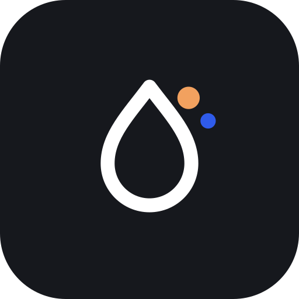
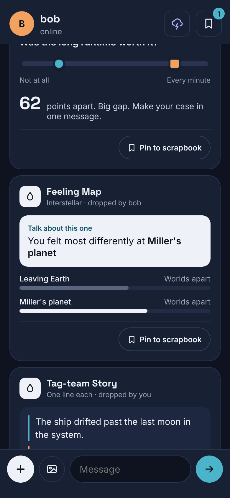
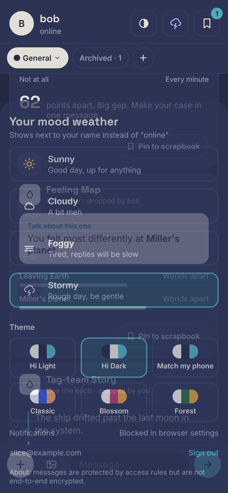

# Hi · Drops Chat

A private chat for exactly two people, with **Tabs** (several parallel conversations, each with its own unread count) and **Drops**: interactive cards you play together in the conversation.

- **Feeling Map**: each of you plots how every scene felt on an intense/calm × heavy/uplifting grid. Dots stay hidden until you both lock in.
- **Blind Reveal**: answer a question privately, then flip together.
- **Gap Slider**: slide your take, then see how many points apart you are.
- **Tag-team Story**: write a story one line each.

It also has text, link previews, photos, a shared scrapbook of pinned moments, "mood weather" next to your name, push notifications, and colour themes (Hi, Midnight dark mode, Classic, Blossom, Forest, or match your phone's light/dark setting).

It's an installable PWA (iPhone and Android) built with Vite + Preact + TypeScript on Firebase, and it's ready to wrap with Capacitor later.
The UI follows the design prototype in `design/`, with the "Hi" navy, teal and alabaster palette as the default theme (the prototype's original colours are the **Classic** theme). `Chat-with-Drops-standalone.html` opens directly in any browser (fonts included); `Chat-prototype.html` is the same design as source markup.

| Chat | Feeling Map | Summary & story |
|---|---|---|
|  |  |  |

| Hi theme | Midnight theme | Theme picker |
|---|---|---|
|  |  |  |

---

## Contents

1. [Run it locally (Emulator Suite)](#1-run-it-locally-emulator-suite)
2. [Tests](#2-tests)
3. [Create the Firebase project](#3-create-the-firebase-project)
4. [Blaze plan + $1 budget alert](#4-blaze-plan--1-budget-alert)
5. [Fill in the config](#5-fill-in-the-config)
6. [Deploy to Firebase Hosting](#6-deploy-to-firebase-hosting)
7. [Install on iPhone (and Android)](#7-install-on-iphone-and-android)
8. [How it works](#8-how-it-works)
9. [Later: native apps with Capacitor](#9-later-native-apps-with-capacitor)

---

## 1. Run it locally (Emulator Suite)

You need **Node 22** and **Java 11+** (the Firestore and Storage emulators run on Java).

```bash
npm install
```

```bash
npm --prefix functions install
```

```bash
npm run dev:all
```

This builds the Cloud Functions, starts the emulators (Auth, Firestore, Storage, Functions, plus the UI at
http://127.0.0.1:4000), and starts the app at **http://localhost:5173**.

`dev:all` always runs against the emulators (project `demo-drops`), never your real `hi-dropchat` data. `npm run dev` on its own runs the app against the **real** project in `src/firebase-config.ts`.

**Signing in locally:** use "E-mail me a sign-in link". The emulator doesn't send e-mail. Open
**Emulator UI → Authentication** (or look in the terminal) and click the sign-in link. "Continue with Google" also works and shows a fake account picker.

**Two people:** use a normal window and a private window (or two browsers). Sign in as `a@example.com`, invite `b@example.com`, then sign in as `b@example.com` in the other window and tap **Join**.

**On your phone (same Wi-Fi):** the emulators listen on `127.0.0.1` only. To test from a phone, change every `"host": "127.0.0.1"` in `firebase.json` to `"0.0.0.0"`, then open `http://<your-computer's-LAN-IP>:5173`. The app looks for the emulators on the same host it was loaded from.

Emulator data is saved to `.emulator-data/` when you stop the emulators.

## 2. Tests

```bash
npm test
```

This runs three suites:

| Suite | What it checks |
|---|---|
| `npm run test:unit` | Link detection, image sizing, labels, Drop registry (every Drop definition is valid) |
| `npm run test:rules` | **Firestore + Storage security rules** against the emulators: only members can read/write, you can only write your own answers, a hidden answer can't be read until both lock in, locked answers are frozen, a third person can never join, photo uploads limited to your own folder and 5 MB |
| `npm --prefix functions test` | Open Graph parsing, SSRF protection for link previews, push text never leaking answers |

There is also a full end-to-end run: two browsers sign in, pair up, chat, send a photo, and play all four Drops against the emulators.

```bash
npm run test:e2e
```

It needs Playwright's Chromium. If you don't have it, run `npx playwright install chromium` once. Screenshots go to `test-results/e2e/`.

## 3. Create the Firebase project

> ✅ Done for `hi-dropchat`: the web config is already in `src/firebase-config.ts` and `.firebaserc`. Check the sign-in providers, Firestore and Storage (steps 2–4), and generate the Web Push key (step 6).

1. Go to https://console.firebase.google.com and choose **Add project**. Name it something like `drops-chat`. Google Analytics isn't needed.
2. **Build → Authentication → Get started.** Then:
   - **Sign-in method → Google**: Enable, pick a support e-mail, Save.
   - **Sign-in method → Email/Password**: Enable, also turn on **Email link (passwordless sign-in)**, Save.
3. **Build → Firestore Database → Create database.** Choose **Production mode** (our rules get deployed over it) and a location near you. You can't change the location later.
4. **Build → Storage → Get started.** This needs the Blaze plan (next step). Use the same location.
5. **Project settings (⚙) → General → Your apps → Web (`</>`).** Register an app called "Drops Chat". You don't need Firebase Hosting setup here. Copy the `firebaseConfig` object.
6. **Project settings → Cloud Messaging → Web configuration → Web Push certificates → Generate key pair.** Copy the key. This is the `vapidKey`.

## 4. Blaze plan + $1 budget alert

Cloud Functions (link previews, push), and Storage on new projects, need the pay-as-you-go **Blaze** plan.
Two people chatting will stay well inside the free quotas, so expect **$0**. The alert is there as a safety net.

1. In the Firebase console, click **Upgrade** (bottom-left, next to "Spark") and choose **Blaze**. Link or create a Cloud Billing account.
2. When asked to set a budget, enter **1** (USD) and confirm. If you skipped it, set one up as follows:
   - Open https://console.cloud.google.com/billing, choose your billing account, then **Budgets & alerts → Create budget**.
   - **Scope:** select your Firebase project only.
   - **Amount:** *Specified amount* → **$1**.
   - **Actions:** keep the 50%, 90% and 100% thresholds and tick **Email alerts to billing admins and users**.
   - Click **Finish**.
3. A budget only **alerts** you; it doesn't stop billing. The functions are capped at 3 instances each (`functions/src/index.ts`) to keep any runaway cost small. If you ever want a hard stop, Google documents a "cap costs by disabling billing" Pub/Sub recipe.

## 5. Fill in the config

> ✅ Already filled in for `hi-dropchat`, except **`vapidKey`** (step 3.6). It's needed for notifications.

For reference, **`src/firebase-config.ts`** looks like this:

```ts
export const firebaseConfig = {
  apiKey: '…',
  authDomain: 'your-project-id.web.app',   // ← see note below
  projectId: 'your-project-id',
  storageBucket: 'your-project-id.firebasestorage.app',
  messagingSenderId: '…',
  appId: '…',
};
export const vapidKey = 'B…';               // from step 3.6
```

> **Sign-in on iPhone:** set `authDomain` to the domain you serve the app from (`your-project-id.web.app`, or your custom domain), **not** `*.firebaseapp.com`. Then the Google sign-in redirect stays on the same site, which Safari and installed Home Screen apps need.

`.firebaserc` already points at `hi-dropchat`. Log the CLI in once:

```bash
npx firebase login
```

Firestore and Functions regions: Functions default to `us-central1`. If your Firestore is elsewhere (for example `europe-west1`), change `region` in `functions/src/index.ts` to match. That's faster, and some regions require it for Firestore triggers.

## 6. Deploy to Firebase Hosting

```bash
npm run deploy
```

That builds the app and the functions, then deploys **Hosting, Firestore rules and indexes, Storage rules, and Functions** in one go. The first deploy may ask you to:

- **Enable APIs** (Cloud Functions, Cloud Build, Artifact Registry, Eventarc): answer **Yes**.
- **Grant Storage access to Firestore** for the cross-service rules (photos are readable only by room members, which the Storage rules check in Firestore): answer **Yes**.

Your app is live at `https://your-project-id.web.app`. Then:

- **Authentication → Settings → Authorized domains:** `your-project-id.web.app` and `firebaseapp.com` are already there. Add any custom domain you use.
- Open the app, sign in, and invite the other person by their e-mail (the one they'll sign in with). Send them the link with **Share invite**.

To deploy only one part later: `npx firebase deploy --only hosting`, `--only firestore:rules,storage`, or `--only functions`.

## 7. Install on iPhone (and Android)

**iPhone / iPad (iOS 16.4+ for notifications):**

1. Open `https://your-project-id.web.app` in **Safari**. It has to be Safari: other iOS browsers can't install web apps with push.
2. Tap **Share** (the square with an up arrow), then **Add to Home Screen**, then **Add**.
3. Open **Drops** from the Home Screen and sign in *inside the app*. The installed app has its own storage, separate from Safari.
   - **Google:** works directly if `authDomain` is your `web.app` domain (step 5).
   - **E-mail link:** the link in the e-mail opens in Safari, not in the installed app. In the app, after "Send link", **long-press the link in Mail → Copy**, then paste it into "Sign in with pasted link".
4. Tap **Turn on** in the notification banner (or **mood weather button → Notifications → Turn on**) and allow notifications.

**Android (Chrome):** open the site and tap **Install app** (or ⋮ → *Add to Home screen*). Notifications work in the browser as well as installed.

## 8. How it works

```
src/
  firebase-config.ts     the hi-dropchat web config (+ vapidKey to add)
  lib/themes.ts          colour themes (add one by adding a palette)
  firebase.ts            init + emulator wiring + offline cache
  app.tsx                auth → lobby (invite/join) → chat
  ui/                    Chat, DropCard (host for plugins), sheets, bubbles, sign-in, lobby
  drops/
    types.ts             the Drop plugin contract (defineDrop, DropApi)
    registry.ts          auto-discovers *.drop.tsx
    feeling-map.drop.tsx, blind-reveal.drop.tsx, gap-slider.drop.tsx, tag-team-story.drop.tsx
  data/                  Firestore/Storage/FCM access, one file per concern
public/sw.js             service worker: offline shell + push display
functions/src/           linkPreview (Open Graph) + notifyPartner (FCM)
firestore.rules          the security model, documented inline
storage.rules
tests/                   unit, rules, e2e
docs/ADDING_A_DROP.md    how to add a new Drop
```

### Data model

```
rooms/{roomId}                      owner, members (max 2), invites [e-mail], timezone (Indian/Maldives)
  members/{uid}                     name, photo, mood weather, lastSeen, typing (+tab), lastRead {tabId: time}
  tabs/{tabId}                      name, colour, archived, order, lastMessageAt   ("general" always exists)
    messages/{id}                   text | link | photo | drop      (append-only)
  pins/{id}                         scrapbook
  drops/{dropId}                    type + content (the Drop's JSON definition snapshot)
    sealed/{uid}_{key}              a PRIVATE answer
    locks/{uid}_{key}               public "I've locked {key}" marker
    entries/{id}                    public, append-only lines
    users/{uid}                     public per-person progress
users/{uid}/tokens/{fcmToken}       push tokens (private)
```

### Why the hidden answers really are hidden

This is enforced in `firestore.rules`, not just in the UI, and covered by `tests/rules/firestore.test.ts`:

- A `sealed` answer can be read by its owner. The **other** member can read it only if the owner has locked it **and** the reader has a lock marker for the same key.
- A lock marker can only be created in the same atomic write as locking your own answer (`getAfter`). So you can't peek without committing.
- Once locked, an answer can never be changed.
- Queries on `sealed` are only allowed when filtered to your own uid, so nobody can list the other person's answers.

### Rooms and invites

- A room is created with exactly one member (you) and one invited e-mail.
- Only a signed-in user whose **verified** e-mail matches the invite can join, and only while the room has one member. After that the room is full forever.
- Until the partner joins, the owner can change the invited address.

### Link previews and push

- **`linkPreview`** runs when a link message is created. It fetches the page (public hosts only: private, loopback and metadata IPs are blocked and re-checked on every redirect; 6 s timeout; 600 KB cap), reads `og:` / `twitter:` / `<title>` tags, and fills them into the message.
- **`notifyPartner`** sends a Web Push to the other person's devices. The text never contains Drop answers. Dead tokens are cleaned up automatically.

### Photos

Photos are re-encoded in the browser to JPEG, longest side **1600 px** (this also strips EXIF/GPS), then uploaded to `rooms/{roomId}/photos/{uid}/…`. Storage rules allow members to read, and the owner to write once (≤ 5 MB, images only).

## Tabs

- Every room has a **General** tab. The **+** at the end of the tab bar adds another (name and colour). Tap the open tab for options: rename, recolour, archive. General can't be archived.
- Unread counts come from `members/{uid}.lastRead[tabId]`, so they sync across your devices. The total also shows on the app icon where the browser supports badges.
- Notifications name the tab ("Sam · Trip plans"), and tapping one opens that tab.
- Drops, docs and sessions belong to a tab. Scrapbook, search and streak are room-wide (see `SPEC.md`).

## Icons and themes

- **Icons:** the sources are `public/icons/logo.svg` (the "Hi" bubble: favicon and in-app mark), `icon.svg` (app icon on alabaster) and `icon-maskable.svg` (Android safe zone). The letters are DM Serif Display outlines (SIL Open Font License), so no font is loaded. After editing an SVG, run `npm run icons` to regenerate the PNGs.
- **Themes:** each person picks one under **mood weather button → Theme**. It's saved on the device and in `users/{uid}`, so it follows them to other devices, and it only changes their own view. To add a theme, add a palette to `src/lib/themes.ts`. The token names are the CSS variables at the top of `src/styles.css`.

## 9. Later: native apps with Capacitor

The app is built to wrap cleanly: relative asset paths (`base: './'`), no server rendering, and no router. Roughly:

```bash
npm i @capacitor/core @capacitor/cli @capacitor/ios @capacitor/android
```

```bash
npx cap init "Drops Chat" com.example.drops --web-dir dist
```

```bash
npm run build && npx cap add ios && npx cap add android
```

In a native shell, swap two web-only pieces for plugins:

- **Push:** use `@capacitor-firebase/messaging` instead of the web FCM token. `src/data/push.ts` is the only file to change. The server function already sends by token.
- **Google sign-in:** use `@capacitor-firebase/authentication` (native sign-in), then sign in to the web SDK with the returned credential (`src/data/auth.ts`).
